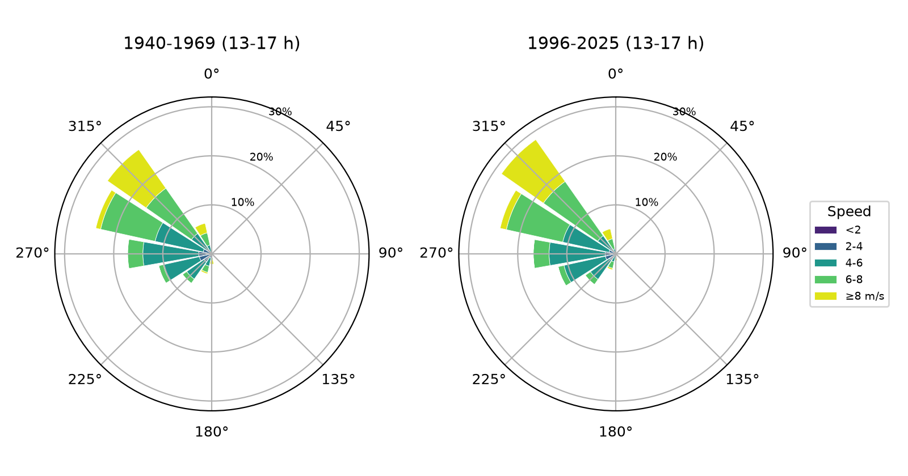
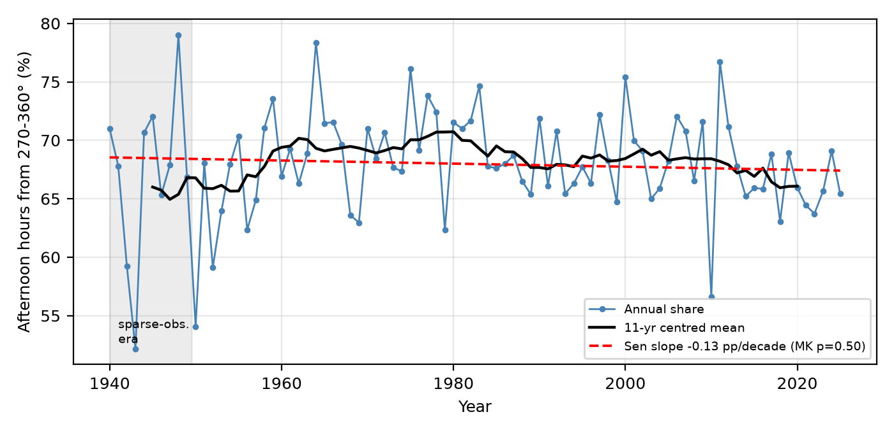
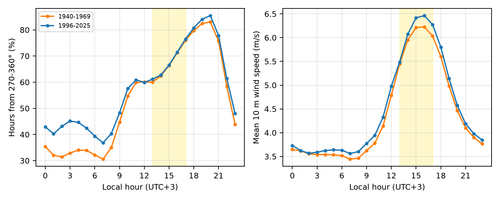
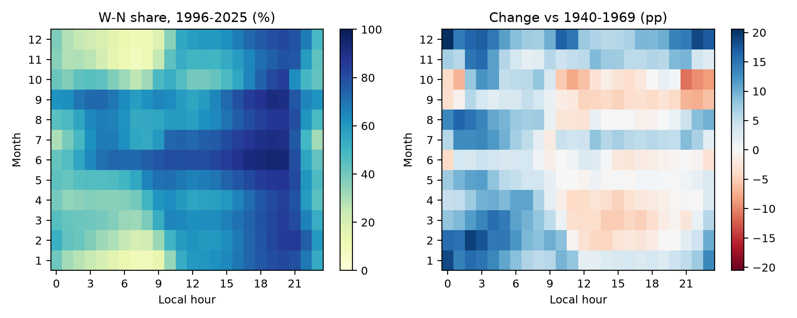

% Is the Rawasheen's Breeze Still There? Afternoon Sea-Breeze Persistence over Historic Jeddah (Al-Balad), 1940–2025
% Amir Khan, Independent Researcher, Jeddah, Saudi Arabia. ORCID: 0009-0008-5996-2841
% Working paper, November 2026

# Abstract

The tall coral-stone houses of Historic Jeddah (Al-Balad) were built around one dependable fact of the local climate: on most afternoons a breeze comes off the Red Sea from the west and north-west. Their projecting wooden screens, the rawasheen (singular rawshan), and the narrow, shaded lanes between them were arranged to catch it. This paper asks a narrow question. Has the frequency of that afternoon onshore wind changed over the eight and a half decades covered by the ERA5 reanalysis? I use 753,888 hourly ERA5 records (1940–2025) for the 0.25° grid cell that contains Al-Balad, retrieved through the Open-Meteo archive, and define the target condition as 10 m wind from 270–360° between 13:00 and 17:00 local time. Across all years, 68.0% of afternoon hours meet that condition. The share was 67.2% in 1940–1969 and 67.7% in 1996–2025. A Mann–Kendall test finds no monotonic trend over 1940–2025 (Kendall's τ = −0.050, p = 0.50; Sen's slope −0.13 percentage points per decade). The result holds across six direction sectors and three afternoon windows: no sector shows a statistically significant trend, and early-to-recent differences range from +0.3 to +2.2 percentage points. Afternoon wind speed rose slightly (5.97 to 6.14 m/s between the two 30-year periods), but that rise sits almost entirely before 1979 and may reflect changes in the observations fed into the reanalysis rather than the climate. At the scale ERA5 can resolve, the regional sea breeze that the rawasheen were designed for is still there. Whether it still reaches the street and the window in today's Jeddah, behind new towers and reclaimed shoreline, is a separate question that a 25 km grid cannot answer.

**Keywords:** Historic Jeddah; Al-Balad; rawshan; sea breeze; natural ventilation; ERA5; Mann–Kendall; Red Sea; vernacular architecture; climate heritage

# 1. Introduction

Anyone who has walked through Al-Balad on a summer afternoon knows the moment when the air begins to move. The old town's builders knew it too. The houses of the Hijazi Red Sea tradition rise four, five, sometimes six storeys. They were built of coral stone (manqabi) with timber ties, and their facades are dominated by rawasheen: large projecting timber windows of lattice and louvre. These elements shade the wall, filter the glare, give privacy, and, above all, let a moving air stream pass through rooms that would otherwise trap the day's heat and humidity. UNESCO's inscription of Historic Jeddah, the Gate to Makkah, in 2014 names these tower houses among the reasons for the site's Outstanding Universal Value (UNESCO World Heritage Centre, n.d.).

A design that relies on a breeze makes an implicit bet on the climate. The bet was placed over centuries of local experience. If the afternoon onshore wind became rarer, shifted direction, or weakened, the passive logic of the buildings would weaken with it. That matters for conservation, because restored houses in Al-Balad are increasingly being reused as museums, hotels and cafés, and their owners must decide how much to rely on natural ventilation and how much on mechanical cooling. It also matters for interpretation: heritage guides routinely describe the rawshan as a "breeze catcher" without asking whether the breeze has behaved the same way through the period of rapid urban growth.

This paper tests one aspect of that bet with a long, consistent and openly available record. The question is deliberately narrow:

> *Has the frequency of westerly-to-northerly afternoon winds over Al-Balad changed between 1940 and 2025, as represented in the ERA5 reanalysis?*

I do not test building performance, indoor comfort or the effect of individual new buildings on airflow in the lanes. Those require measurements or simulations at the scale of metres, and several studies have begun that work (Abdel Gelil Mohamed, 2026; Ghabra & Ford, 2015). What a reanalysis can do is describe the regional wind that arrives at the city's edge. That regional wind is the precondition for everything the rawasheen do, and it has not, to my knowledge, been examined as a long time series for this purpose.

The contribution is threefold. First, I build an 86-year hourly wind record for the grid cell containing Al-Balad and summarise it in terms that relate to the buildings: direction sector, time of day and season. Second, I test for monotonic change with nonparametric methods that make few assumptions about the data and check the result against reasonable alternative definitions. Third, I set out plainly what the result does and does not imply, given the coarse resolution of the data.

# 2. Background

## 2.1 The rawshan and the ventilation logic of Hijazi houses

The rawshan is the Hijazi form of a wider family of projecting timber screens known across the Islamic world, including the mashrabiya of Cairo. Abdelkader and Park (2018) review how the traditional mashrabiya combined privacy, shading and airflow, and how its principles have been reinterpreted in contemporary facades. In Jeddah, the rawasheen are large: a single unit can run through several storeys, and the louvred panels can be opened or shut independently, so that occupants could control the size and position of openings through the day.

Simulation studies of particular Jeddah houses support the idea that the rawasheen are environmental devices and not just ornament. Ghabra and Ford (2015) evaluated the thermal performance of Nasif House, one of the best-known houses of the old town. Abdel Gelil Mohamed (2026) compared two houses, Beit Al-Sharbatly and Beit Baeshen, with and without their rawasheen. The rawasheen reduced solar heat gains through windows by between 25% and 71% and lowered indoor operative temperature by about 1.1 °C under extreme summer conditions; ventilation rates and airflow velocity were also examined. These results depend on the wind boundary conditions fed into the simulations, which is why a long view of the wind itself is useful.

The houses are also fragile. Coral stone and timber need maintenance, and repair practice in Historic Jeddah has had to balance authenticity with durability (Adas & Alaidaroos, 2017). A building whose ventilation works poorly is more likely to be sealed and air-conditioned, which changes its moisture regime and, eventually, its fabric. The climate premise of the design is therefore part of the conservation problem, not a side issue.

## 2.2 The sea breeze on the central Red Sea coast

A sea breeze forms when land heats faster than the adjacent sea during the day, producing a shallow, onshore flow that typically begins in late morning, peaks in the afternoon and dies after sunset (Miller et al., 2003). Its strength depends on the land–sea temperature contrast and on the background, synoptic-scale wind with which it combines. On the central Red Sea coast the background flow is itself mostly from the north-north-west for much of the year, channelled along the axis of the sea. Langodan et al. (2014) describe the Red Sea as a "natural laboratory" for wind modelling precisely because of this strong channelling, the steep mountains on both coasts and the resulting local winds. A recent model-based climatology of land and sea breezes along both Red Sea coasts confirms that these circulations are a regular, seasonally varying feature of the basin (Thomas et al., 2026).

For Jeddah, whose coast runs roughly north-north-west to south-south-east, a wind from the west to north-west is onshore or nearly so. That direction is what the city's older fabric faces: the main facades and the larger rawasheen tend to open towards the sea and the prevailing wind.

## 2.3 Long-term change in near-surface winds

There are reasons to expect change. Many land stations in the Northern Hemisphere recorded declining near-surface wind speeds from the 1960s into the 2000s, a pattern called "stilling" (McVicar et al., 2012). Vautard et al. (2010) attributed part of that decline to increased surface roughness: more buildings, trees and other obstacles. Over the Red Sea, Langodan et al. (2018) found a general decrease in wave energy over a 30-year simulation, which they linked to a specific weather pattern, with the strongest decrease in the northern storms. Warming over land could, in principle, strengthen the land–sea contrast that drives a sea breeze, while changes in the large-scale circulation could alter the background flow. The direction of any net effect on Jeddah's afternoon breeze is not obvious, which is a good reason to look at the data.

# 3. Data and methods

## 3.1 Study site and grid cell

Al-Balad lies on the eastern shore of the Red Sea at about 21.485° N, 39.187° E. The World Heritage property covers 17.92 ha, with a buffer zone of 113.58 ha (UNESCO World Heritage Centre, n.d.). Figure 1 shows the old town, the modern city around it and the ERA5 grid cell used here.

The analysis uses ERA5, the fifth-generation global atmospheric reanalysis of the European Centre for Medium-Range Weather Forecasts (Hersbach et al., 2020), which has been extended back to 1940 (Bell et al., 2021). ERA5 combines a numerical weather model with historical observations to produce gridded hourly fields on a regular latitude–longitude grid of 0.25°, about 26 km by 28 km at this latitude. I retrieved the data through the Open-Meteo Historical Weather API (Zippenfenig, 2024) with the model explicitly set to ERA5, requesting hourly 10 m wind speed and direction for the coordinate of Al-Balad. The API returned the nearest grid point, 21.5° N, 39.25° E, at a model elevation of 12 m. Al-Balad lies about 7 km west-south-west of that point but inside the cell it represents. Times were requested in local time (UTC+3; Saudi Arabia does not observe daylight saving time).

The cell is mostly land. Its western edge includes the coastline and the old port, and the rest covers the modern city and its eastern suburbs. In a reanalysis, the value at a grid point is an area-representative estimate, not a point measurement. The implications are discussed in Section 6.

## 3.2 Variables and definitions

Wind direction follows the meteorological convention: the direction *from which* the wind blows, in degrees clockwise from north. The main target condition is an hour in which the 10 m wind comes from 270° to 360° inclusive, that is, from due west through north-west to due north. I call this the W–N sector, and its frequency the *W–N share*. The sector is broad on purpose. It captures both the pure sea breeze and the channelled north-north-westerly background flow, which together produce the onshore afternoon wind that Al-Balad's facades face. Section 3.4 tests narrower and wider sectors.

The main time window is 13:00 to 17:00 local time, five hourly values per day. This window covers the hottest part of the day, when the need for ventilation is greatest and the land–sea temperature contrast is usually strongest. For each calendar year I computed the W–N share of afternoon hours; the mean afternoon wind speed; the mean speed during onshore (W–N) afternoon hours; and the share of afternoon hours with speed below 2 m/s, a rough indicator of light or calm conditions in which cross-ventilation becomes weak.

## 3.3 Trend tests

I tested each annual series for monotonic trend with the Mann–Kendall test (Mann, 1945) and estimated its magnitude with Sen's slope (Sen, 1968), which is the median of all pairwise slopes and is robust to outliers. Because annual climate series can be serially correlated, which inflates the apparent significance of the original test, I also report the variance-corrected test of Hamed and Rao (1998). Calculations used the pyMannKendall package (Hussain & Mahmud, 2019). Slopes are expressed per decade.

The early part of ERA5 is less constrained by observations. Before the late 1940s, and again before the satellite era began in 1979, fewer upper-air soundings and surface reports went into the assimilation (Bell et al., 2021; Hersbach et al., 2020). A trend that appears only when the early years are included could therefore be an artefact. To check this, each test was repeated for three periods: 1940–2025, 1950–2025 and 1979–2025.

## 3.4 Decade comparison and sensitivity checks

Alongside the trend tests, I compare decades and two 30-year periods: an *early* period (1940–1969) and a *recent* period (1996–2025). Thirty years is the conventional length of a climate normal. The two windows are separated by a quarter of a century, during which Jeddah grew from a mid-sized port into a city of several million.

The sensitivity analysis repeats the early–recent comparison and the trend test for six direction sectors and three afternoon windows. The sectors are: the main 270–360° sector; 247.5–337.5° (WSW to NNW, on a 16-point compass); 225–360° (SW to N); 270–337.5° (W to NW); 292.5–337.5° (NW only); and 250–340°, a sector of ±45° around the approximate onshore normal of this coast. The windows are 12:00–16:00, 13:00–17:00 and 14:00–18:00.

## 3.5 Descriptive figures and reproducibility

The wind roses (Figure 3) show the joint distribution of direction (16 sectors) and speed (five classes) for afternoon hours in the early and recent periods. The diurnal cycle (Figure 5) shows the W–N share and mean speed at each hour of the day. The month-by-hour heatmaps (Figure 6) show the recent W–N share and its change from the early period.

All numbers in this paper are produced by a single script (`code/analysis.py`). It downloads the data if they are absent and writes every table and figure. The script re-downloads the raw Open-Meteo response when it is not present locally (Section 8).

# 4. Results

## 4.1 Data summary

Table 1 summarises the record. Of 753,888 hourly values, one hour lacked both speed and direction and was dropped. The afternoon window contains 157,060 hours. Over the full record, 68.0% of afternoon hours had wind from the W–N sector, against 55.9% of all hours. The difference is the daytime onshore regime showing through.

TABLE: tables/table1_data_summary.csv | Table 1. Data summary for the ERA5 grid cell containing Al-Balad.

## 4.2 The afternoon wind rose, then and now

The two wind roses in Figure 3 are hard to tell apart. In both periods the afternoon wind comes overwhelmingly from the north-west quadrant. The 315° (NW) and 292.5° (WNW) sectors are the largest single petals, and winds from the east and south-east are rare. The recent rose has a slightly larger fraction of north-westerly winds above 8 m/s. The circular mean direction of afternoon winds was between 281.7° and 286.5° in every decade (Table 3), a spread of under five degrees.

## 4.3 Trend in the W–N afternoon share

Figure 4 shows the annual W–N share of afternoon hours. Year-to-year variation is substantial: the standard deviation is 4.6 percentage points. The extremes both fall in the 1940s, a low of 52.2% in 1943 and a high of 79.0% in 1948, which is the decade most likely to be affected by sparse observations. In 1940 the share was 71.0%; in 2025 it was 65.4%. Read in isolation, those two endpoints suggest a decline, but they are single noisy years, and the full series tells a different story.

The Mann–Kendall test finds no monotonic trend over the full record (τ = −0.050, p = 0.50). The Sen slope is −0.13 percentage points per decade, roughly one percentage point across the whole 86 years. Starting the series in 1950 gives the same answer (−0.22 pp per decade, p = 0.36). For 1979–2025 the slope is steeper, −0.64 pp per decade, with p = 0.071. That falls short of the conventional 5% level. I flag it as a possible weak recent decline, not as evidence of one, and the decadal values in Table 3 show why. The 2000s had one of the highest shares on record (69.5%), and the lower values of the 2010s (67.0%) and the incomplete 2020s (65.7%) are matched by the 1950s (65.5%).

TABLE: tables/table2a_trend_tests.csv | Table 2. Mann–Kendall trend tests and Sen's slopes for annual afternoon (13:00–17:00) wind statistics. p_MK: original test; p_HR: Hamed–Rao variance-corrected test. Slopes per decade.

TABLE: tables/table2b_decades.csv | Table 3. Decade comparison of afternoon (13:00–17:00) winds. The 2020s cover 2020–2025 only.

## 4.4 Wind speed

The afternoon wind became slightly stronger, not weaker. Mean afternoon speed was 5.97 m/s in 1940–1969 and 6.14 m/s in 1996–2025. During onshore hours the corresponding figures were 6.46 and 6.63 m/s. Over 1940–2025 these increases are statistically significant (Sen slopes of +0.026 and +0.033 m/s per decade; p < 0.001 in the original test and p ≤ 0.001 after the Hamed–Rao correction). The share of light afternoon winds below 2 m/s fell, by 0.07 pp per decade. Restricting the series to 1979–2025, however, removes the speed signal almost entirely: the slope drops to +0.005 m/s per decade (p = 0.71). Almost all of the long-term strengthening happened before the satellite era. A change of this size and timing is more plausibly linked to the evolving mix of observations assimilated by ERA5 than to a physical change in the breeze, and I do not interpret it as a climate signal.

## 4.5 Diurnal and seasonal structure

The daily cycle is clear and has hardly changed (Figure 5). The W–N share is lowest at 07:00 (34.4% over the full record), when the night-time land breeze and the background easterly or southerly components are at their strongest. It rises steeply through the late morning and peaks at 20:00 (84.8%), several hours after the hottest part of the afternoon. Wind speed follows a related but earlier curve: it is lowest overnight (about 3.5 m/s) and peaks at 16:00 (6.4 m/s), so the strongest onshore wind arrives in the hottest hours, while the direction stays onshore well into the evening. The early and recent curves lie almost on top of each other. The lag of the peak into the evening is consistent with the sea breeze combining with the channelled north-north-westerly flow, and it means the onshore wind remains available after sunset, when Jeddah's houses traditionally opened up for the night.

The seasonal contrast is larger than the long-term change. The afternoon W–N share is highest in June (86.8%) and lowest in October (50.2%), when the background flow over the central Red Sea is weakest and most variable. Figure 6 shows that the recent period differs from the early one by month. Late autumn and winter afternoons became more north-westerly (November +6.9 pp, December +6.8 pp, January +2.9 pp), and so did July (+6.4 pp). Spring and early autumn shifted the other way (March −4.6 pp, September −4.0 pp). Within the 13:00–17:00 window, individual month–hour cells changed by between −5.3 and +9.4 percentage points. Because these shifts partly cancel, the annual afternoon share barely moves. They may, however, be relevant to how the houses perform in particular seasons, and they are the most promising lead for future work.

## 4.6 Sensitivity to definitions

Table 4 repeats the analysis for alternative sectors and windows. The pattern is the same throughout. In every case the recent share is within about two percentage points of the early one, ranging from +0.3 pp (W–N, 12:00–16:00) to +2.2 pp (NW only). No trend reaches significance: the smallest p-value is 0.13, for the broad SW–N sector, whose slope is positive. The main result does not depend on how the onshore sector or the afternoon is defined.

TABLE: tables/table3_sensitivity.csv | Table 4. Sensitivity of the early (1940–1969) versus recent (1996–2025) comparison and of the 1940–2025 trend to the direction sector and afternoon window.

# 5. Discussion

## 5.1 What the result says

At the scale of the regional wind field, the climatic premise behind the rawshan has held. In ERA5, about two afternoon hours in three bring wind from between west and north over Jeddah. That was true in the 1940s and it is true now, with no detectable monotonic change in frequency over 86 years and a slight, probably partly artificial, increase in speed. Direction is stable too: the mean afternoon direction stayed within five degrees across nine decades. A builder who oriented a rawshan towards the north-west in the nineteenth century made a choice that the regional climate has continued to reward.

The finding sits comfortably with what is known about the region. The Red Sea's afternoon winds are controlled by robust features: the land–sea temperature contrast, the mountain barrier of the Hijaz and the funnelling of the sea's long axis (Langodan et al., 2014; Thomas et al., 2026). None of these is likely to change much over decades. The stilling reported at many land stations (McVicar et al., 2012; Vautard et al., 2010) is largely a surface-roughness effect at the measurement site, and a reanalysis grid cell is not designed to capture it. Section 6 returns to this point.

## 5.2 What the result does not say

A stable regional breeze does not mean a stable breeze in the lanes of Al-Balad. Between the two periods compared here, Jeddah's corniche was reclaimed and rebuilt, the port expanded and towers rose to the north and west of the old town. Each of these can slow, deflect or block the wind before it reaches a rawshan. The ERA5 grid cell averages over roughly 700 km² and uses a simplified description of the land surface, so it cannot see these obstacles. The wind it reports is better thought of as the wind *offered* to the city than the wind *received* by any single facade.

That distinction suggests a division of labour. Reanalysis can answer the question asked here: whether the regional resource has changed. It cannot answer how much of that resource reaches the buildings today. That requires street-level anemometry, wind-tunnel work or computational fluid dynamics using the regional wind statistics in this paper as boundary conditions. The simulations of Abdel Gelil Mohamed (2026) and Ghabra and Ford (2015) are a starting point; the seasonal statistics in Figure 6 could make such simulations more representative.

## 5.3 Implications for conservation and reuse

With that caveat, the result offers modest practical guidance. Restoration that keeps the rawasheen operable, with louvres that open and lattices that are not sealed, is not working against a vanishing climate resource. The case for passive ventilation as a first measure in reused houses, backed by mechanical cooling only in the hottest and most humid periods, is at least not undermined by the regional wind record. The month-level shifts point to where the backup will be needed most. Late summer and early autumn, when the W–N share is lowest and humidity is high, are the obvious candidates, and September afternoons became somewhat less north-westerly in the recent period.

The result also gives heritage interpretation something concrete to say. A visitor can be told that the breeze the rawshan was built for still blows on about two afternoons in three, just as it did when the first ERA5 records begin. That is a modest but defensible claim, and more useful than an unexamined appeal to tradition.

# 6. Limitations

**Spatial resolution.** This is the main limitation and deserves a full account. ERA5's native grid is 0.25°, about 26 by 28 km here, and the grid point that supplies the data (21.5° N, 39.25° E) lies about 7 km inland of Al-Balad. The cell's mixture of sea and land is represented by a single land–sea fraction, and its terrain and roughness are averages. Real sea breezes have fronts that move inland by a few kilometres an hour, and their onset time and strength vary over distances much smaller than one grid cell (Miller et al., 2003). ERA5 resolves the regional circulation but smooths the details. It may also misplace the timing of the breeze, which could help explain why the W–N share peaks at 20:00, later than a classic coastal sea breeze would. None of this invalidates a comparison of the same cell with itself over time, as long as the model and its land surface description stay fixed, which they do within ERA5. It does mean that the absolute percentages should not be read as what an anemometer in Al-Balad would record.

**Urban effects are absent by construction.** ERA5's land-surface scheme does not represent Jeddah's growth as changing roughness over time. Any reduction of wind at street level due to urbanisation is invisible to it. The stability found here is the stability of the regional, not the local, wind.

**Inhomogeneity of the reanalysis.** The observations assimilated into ERA5 changed greatly over 86 years, especially with the arrival of satellite data in the 1970s (Bell et al., 2021; Hersbach et al., 2020). The 1940s record is the least constrained, which is why the annual extremes falling in that decade should be treated with caution. I addressed this by repeating tests for 1950 and 1979 onwards. The direction result survives all three periods; the speed result does not, which is why I do not claim it.

**No direct validation.** I did not compare the ERA5 series with station observations from King Abdulaziz International Airport or the Jeddah Islamic Port, because I could not obtain a long, documented open record for either within this study. Such a comparison would be the most valuable next step.

**Definitions.** The W–N sector and the afternoon window are judgement calls. Table 4 shows that the conclusion is insensitive to reasonable alternatives, but other definitions, for example a sea-breeze identification based on a reversal of the morning land breeze, could pick out a different subset of days.

**Single variable.** Ventilation comfort also depends on temperature and humidity. I considered only wind, and only at 10 m. Upper-floor rawasheen sit at 10–20 m above street level, which is close to the 10 m reference height; ground-floor openings sit well below it.

# 7. Conclusion

In the ERA5 record for the grid cell containing Historic Jeddah, the afternoon onshore wind is as frequent now as it was eighty years ago. About 68% of hours between 13:00 and 17:00 bring wind from between west and north. The share differs by less than half a percentage point between 1940–1969 and 1996–2025, and no direction definition or time window yields a significant trend. The mean afternoon direction has stayed within five degrees of 284°. Speed rose slightly, but mostly before 1979, and probably reflects the reanalysis more than the climate. The seasonal pattern has shifted modestly towards more north-westerly winter and July afternoons and fewer in spring and September.

The rawasheen were designed around a regional wind that, as far as a 25 km reanalysis can tell, has not gone away. Whether it still reaches them through the modern city is the next question, and answering it will need measurements in the lanes of Al-Balad.

# 8. Data and code availability

The wind data are ERA5 hourly fields (Hersbach et al., 2020) retrieved on 2 November 2026 through the Open-Meteo Historical Weather API (Zippenfenig, 2024), request: https://archive-api.open-meteo.com/v1/archive?latitude=21.485&longitude=39.186&start_date=1940-01-01&end_date=2025-12-31&hourly=wind_speed_10m,wind_direction_10m&models=era5&wind_speed_unit=ms&timezone=Asia%2FRiyadh. ERA5 contains modified Copernicus Climate Change Service information; neither the European Commission nor ECMWF is responsible for any use made of it. The raw response (`data/openmeteo_era5_albalad_1940_2025.json`), the analysis script (`code/analysis.py`), the Python requirements (`requirements.txt`), all output tables (`tables/`) and the machine-readable summary of quoted numbers (`results.json`) are in the paper's folder. Running `python code/analysis.py` regenerates every number, table and figure. Map tiles are © OpenStreetMap contributors, available under the Open Database Licence. The photograph in Figure 2 is reproduced under CC BY-SA 4.0. The code, tables, figures and paper are openly available at https://github.com/amirator/al-balad-sea-breeze-era5 (code under the MIT licence; text and original figures under CC BY 4.0). The raw ERA5 response (about 21 MB) is not stored in the repository; the script re-downloads it. An archived version will be deposited on Zenodo: DOI [to be added].

# References

Abdel Gelil Mohamed, N. (2026). Environmental performance of rawashin in the traditional Hijazi houses of Historic Jeddah: A comparative simulation study of Beit Al-Sharbatly and Beit Baeshen. *Materials Research Proceedings, 72*, 50–63. https://doi.org/10.21741/9781644904336-6

Abdelkader, R., & Park, J.-H. (2018). Sustainable building façades: Modern usages of the traditional mashrabiya. *Open House International, 43*(2), 69–76. https://doi.org/10.1108/OHI-02-2018-B0010

Adas, A. A., & Alaidaroos, M. Y. (2017). A sustainable repair process for heritage buildings in historic Jeddah. In *Vernacular and earthen architecture: Conservation and sustainability* (pp. 17–21). CRC Press. https://doi.org/10.1201/9781315267739-3

Bell, B., Hersbach, H., Simmons, A., Berrisford, P., Dahlgren, P., Horányi, A., Muñoz-Sabater, J., Nicolas, J., Radu, R., Schepers, D., Soci, C., Villaume, S., Bidlot, J.-R., Haimberger, L., Woollen, J., Buontempo, C., & Thépaut, J.-N. (2021). The ERA5 global reanalysis: Preliminary extension to 1950. *Quarterly Journal of the Royal Meteorological Society, 147*(741), 4186–4227. https://doi.org/10.1002/qj.4174

Ghabra, N. A., & Ford, B. (2015). Evaluation of thermal performance in traditional Red-Sea style houses: Case study of Nasif historical house, in Jeddah, Saudi Arabia. In *Proceedings of the Eighth Saudi Students Conference in the UK* (pp. 793–800). Imperial College Press. https://doi.org/10.1142/9781783269150_0065

Hamed, K. H., & Ramachandra Rao, A. (1998). A modified Mann-Kendall trend test for autocorrelated data. *Journal of Hydrology, 204*(1–4), 182–196. https://doi.org/10.1016/S0022-1694(97)00125-X

Hersbach, H., Bell, B., Berrisford, P., Hirahara, S., Horányi, A., Muñoz-Sabater, J., Nicolas, J., Peubey, C., Radu, R., Schepers, D., Simmons, A., Soci, C., Abdalla, S., Abellan, X., Balsamo, G., Bechtold, P., Biavati, G., Bidlot, J., Bonavita, M., … Thépaut, J.-N. (2020). The ERA5 global reanalysis. *Quarterly Journal of the Royal Meteorological Society, 146*(730), 1999–2049. https://doi.org/10.1002/qj.3803

Hussain, M., & Mahmud, I. (2019). pyMannKendall: A python package for non parametric Mann Kendall family of trend tests. *Journal of Open Source Software, 4*(39), 1556. https://doi.org/10.21105/joss.01556

Langodan, S., Cavaleri, L., Pomaro, A., Portilla, J., Abualnaja, Y., & Hoteit, I. (2018). Unraveling climatic wind and wave trends in the Red Sea using wave spectra partitioning. *Journal of Climate, 31*(5), 1881–1895. https://doi.org/10.1175/JCLI-D-17-0295.1

Langodan, S., Cavaleri, L., Viswanadhapalli, Y., & Hoteit, I. (2014). The Red Sea: A natural laboratory for wind and wave modeling. *Journal of Physical Oceanography, 44*(12), 3139–3159. https://doi.org/10.1175/JPO-D-13-0242.1

Mann, H. B. (1945). Nonparametric tests against trend. *Econometrica, 13*(3), 245–259. https://doi.org/10.2307/1907187

McVicar, T. R., Roderick, M. L., Donohue, R. J., Li, L. T., Van Niel, T. G., Thomas, A., Grieser, J., Jhajharia, D., Himri, Y., Mahowald, N. M., Mescherskaya, A. V., Kruger, A. C., Rehman, S., & Dinpashoh, Y. (2012). Global review and synthesis of trends in observed terrestrial near-surface wind speeds: Implications for evaporation. *Journal of Hydrology, 416–417*, 182–205. https://doi.org/10.1016/j.jhydrol.2011.10.024

Miller, S. T. K., Keim, B. D., Talbot, R. W., & Mao, H. (2003). Sea breeze: Structure, forecasting, and impacts. *Reviews of Geophysics, 41*(3). https://doi.org/10.1029/2003RG000124

OpenStreetMap contributors. (2026). *OpenStreetMap* [Map data and tiles]. OpenStreetMap Foundation. Retrieved November 2, 2026, from https://www.openstreetmap.org/copyright

Saudi Press Agency. (2025). *Rawasheen; a model of traditional Saudi wooden architecture in Historic Jeddah, Saudi Arabia (2025)* [Photograph]. Wikimedia Commons. CC BY-SA 4.0. https://commons.wikimedia.org/wiki/File:Rawasheen;_A_Model_of_Traditional_Saudi_Wooden_Architecture_in_Historic_Jeddah,_Saudi_Arabia_(2025).jpg

Sen, P. K. (1968). Estimates of the regression coefficient based on Kendall's tau. *Journal of the American Statistical Association, 63*(324), 1379–1389. https://doi.org/10.1080/01621459.1968.10480934

Thomas, B., Viswanadhapalli, Y., Dasari, H. P., Kunchala, R. K., Langodan, S., Abualnaja, Y., & Hoteit, I. (2026). Climatological features of land–sea breeze circulation along the Red Sea coasts. *Theoretical and Applied Climatology, 157*(2), Article 118. https://doi.org/10.1007/s00704-025-06008-7

UNESCO World Heritage Centre. (n.d.). *Historic Jeddah, the Gate to Makkah* (World Heritage List No. 1361; inscribed 2014). Retrieved November 2, 2026, from https://whc.unesco.org/en/list/1361

Vautard, R., Cattiaux, J., Yiou, P., Thépaut, J.-N., & Ciais, P. (2010). Northern Hemisphere atmospheric stilling partly attributed to an increase in surface roughness. *Nature Geoscience, 3*(11), 756–761. https://doi.org/10.1038/ngeo979

Zippenfenig, P. (2024). *Open-Meteo.com weather API* (Version 1.4.0) [Computer software]. Zenodo. https://doi.org/10.5281/zenodo.7970649
